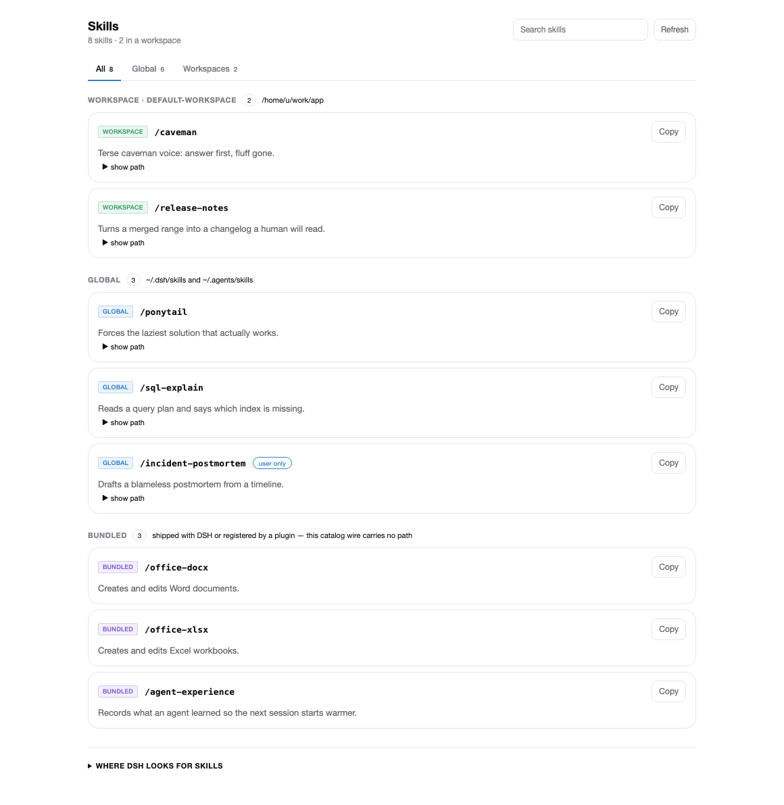
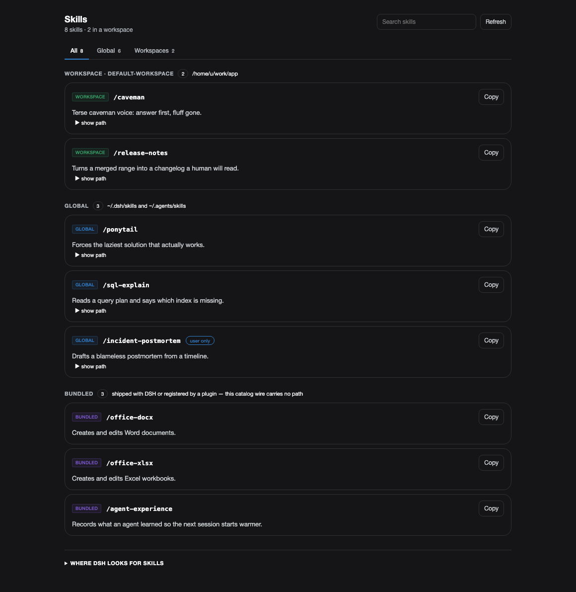
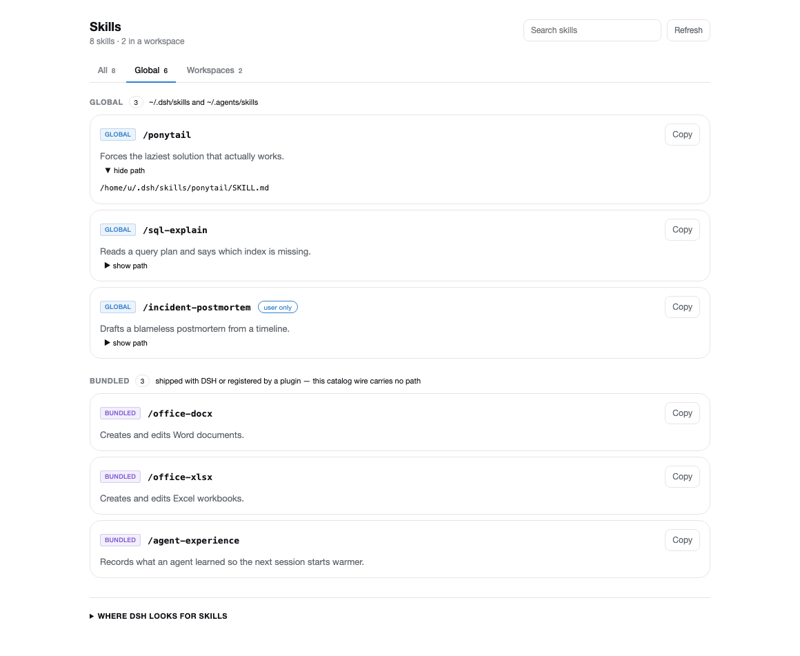
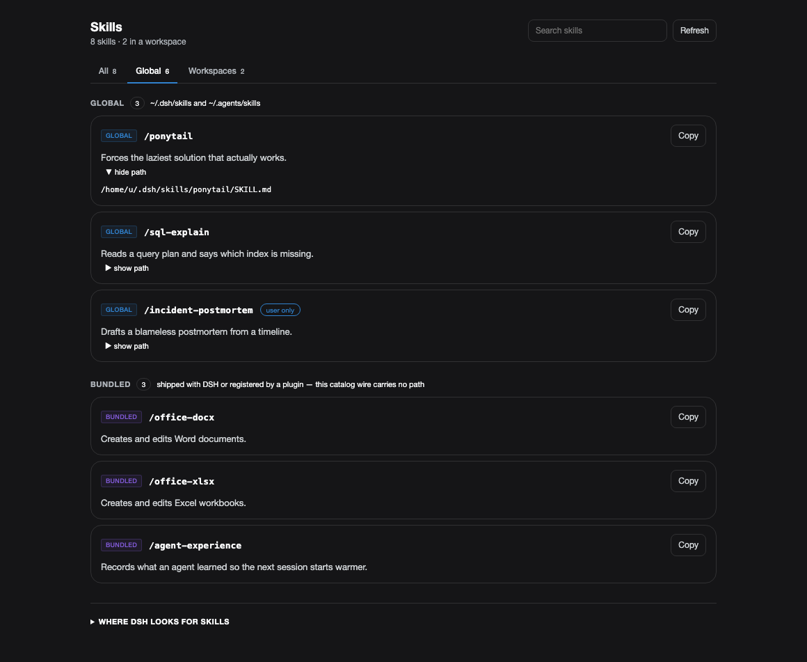
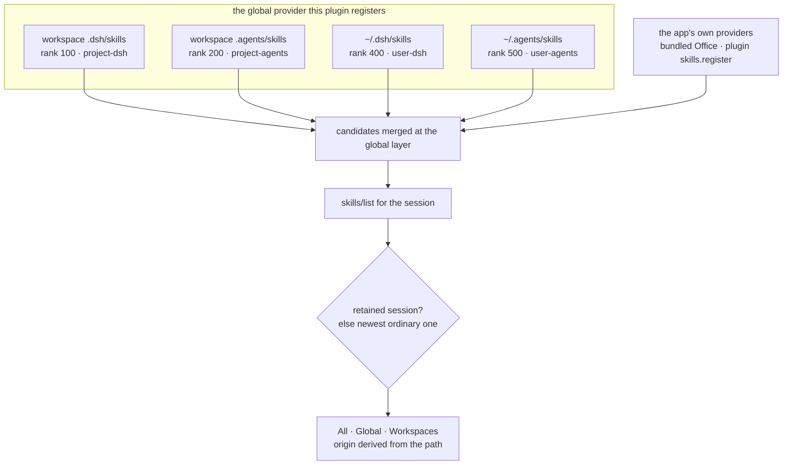

# dsh-skill-managers

A **Skills** page for the DSH Web GUI — its own sidebar entry beside *Plugins*, listing every skill
DSH can see, grouped **All · Global · Workspaces**, with search, copy-command, per-skill origin, and
the roots DSH discovers skills from.

## Why

The page exists because DSH shows a cold session almost none of your skills, and the reason is
structural rather than a bug.

The client reaches skills through `skills/list` — a **session-addressed** Remote. DSH deliberately
keeps filesystem discovery out of the host layer:

```yaml
# dsh-web-app/cordis.patch.yml
# the base host `skill-filesystem` row is disabled here (presets own local discovery)
- id: skill-filesystem
  disabled: true
```

So `~/.dsh/skills` and `<workspace>/.dsh/skills` exist only inside a **live agent's** preset scope. A
cold session falls back to the global layer, which carries no filesystem provider:

```js
// dsh-api-session-controller/lib/types/skill-catalog.js
const scoped = live === undefined ? undefined : presets?.serviceFor(live, 'skills');
const skillRegistry = scoped ?? this.ctx.get('skills');   // ← cold session
```

The first version of this page therefore showed four pathless entries — three Office skills plus a
plugin-registered one — and **nothing** from `~/.dsh/skills`.

The fix is not to view per session. It is to **register a global provider** that scans the roots
itself. Because the catalog falls back to the global layer, every session then sees the complete set,
and the browser half is free to present categories rather than sessions. The session remains only as
transport.

## Quick Start

The plugin installs into your DSH **profile** by link — it is not published to npm, so the clone is
the source. Both routes end with a **restart**.

### Option A — the script

```bash
git clone https://github.com/mrdhira/dsh-skill-managers.git ~/.dsh/plugins/dsh-skill-managers
cd ~/.dsh/plugins/dsh-skill-managers
./install.sh                 # builds, registers in your profile, runs pnpm install
```

It accepts `--profile <dir>` to target a profile other than `~/.dsh/profiles/desktop`, `--check` to
report what would change without writing anything, and `--remove` to unregister.

### Option B — the manual steps

**1. Clone it somewhere stable** (this path becomes your install path):

```bash
git clone https://github.com/mrdhira/dsh-skill-managers.git ~/.dsh/plugins/dsh-skill-managers
cd ~/.dsh/plugins/dsh-skill-managers
```

**2. Build it.** `pnpm install` runs the `prepare` script, which builds `lib/**` — the part DSH
actually loads. It is generated; never hand-edit it.

```bash
pnpm install
```

**3. Register it with your profile** — the dependency and the bundle name, with an absolute path:

```json
{
  "dependencies": {
    "dsh-skill-managers": "link:/Users/<you>/.dsh/plugins/dsh-skill-managers"
  },
  "dsh": {
    "profile": {
      "bundles": [
        "dsh-skill-managers"
      ]
    }
  }
}
```

**4. Install the link, then restart DSH:**

```bash
cd ~/.dsh/profiles/desktop && pnpm install
```

Nothing needs adding to `cordis.patch.yml`: the bundle declares its own Loader row.

> **Restart, don't reload.** The host half loads once per app process, so a host-side change needs a
> full quit and reopen (`⌘Q`, then reopen). A page reload does not pick it up. A client-side (UI)
> change needs the bundle toggled in the plugin manager.

### Verify it is really working

A **Skills** entry should appear in the sidebar beside *Plugins*, listing your skills. If it does
not:

- `lib/v1/index.js` exists — if not, `pnpm install` did not finish building;
- the profile's `package.json` names `dsh-skill-managers` in **both** `dependencies` and
  `dsh.profile.bundles`;
- DSH was **restarted** after installing.

Two ways to see it clearly:

```bash
# the host half answers with its Loader identity
node -e "import('./lib/v1/index.js').then(m => console.log(m.name))"   # dsh-skill-managers

# what the page will list, straight from the roots (no DSH needed)
find ~/.dsh/skills ~/.agents/skills -maxdepth 2 -name SKILL.md 2>/dev/null
```

### Configure

**There is nothing to configure.** The plugin reads the catalog the host already serves through the
existing `skills/list` Remote, and scans the roots below on its own. No settings, no patch fields —
its whole surface is the page.

What it scans, ranked to mirror `@deepseek-ai/dsh-skill-filesystem` so a duplicate name resolves the
same way it does inside a preset:

| Rank | Root | Source |
|---|---|---|
| 100 | `<workspace>/.dsh/skills` | `project-dsh` |
| 200 | `<workspace>/.agents/skills` | `project-agents` |
| 400 | `~/.dsh/skills` | `user-dsh` |
| 500 | `~/.agents/skills` | `user-agents` |
| 600 | shipped with the app | `bundled` (app providers) |

Workspaces come from the live `workspaces` service, so a new workspace appears without a code change
or a restart.

## How it Works

The host half registers one **global** skill provider that scans the roots above. The browser half
renders the catalog through two slot contributions under the key `skills`: a `sidebar.panellist`
entry (the sidebar item, drawing between *Plugins* at 0 and *Automation tasks* at 10), and a `main`
panel that receives its services through `inject`.

```
┌ Skills ─────────────────────────────────── [ search ]  [ Refresh ]
│ 17 skills · 4 in a workspace
│
│  All 17   Global 13   Workspaces 4
│
│  WORKSPACE · default-workspace                    4
│  workspace  /caveman                                    [ Copy ]
│  Terse caveman voice: answer first, fluff gone.         ▶ show path
│
│  GLOBAL                                          13
│  global  /ponytail                                      [ Copy ]
│  Forces the laziest solution that actually works.       ▶ show path
│
│  BUNDLED                                          3
│  bundled  /office-docx                                  [ Copy ]
└──────────────────────────────────────────────────────────────────
```

| Category | What it shows |
|---|---|
| **All** | Everything the provider found, grouped by origin |
| **Global** | `~/.dsh/skills`, `~/.agents/skills`, bundled, and other non-project roots |
| **Workspaces** | Skills under each registered workspace's `.dsh/skills` / `.agents/skills` |

### Origins

`skills/list` returns only `{ name, path?, description, whenToUse?, modelInvocable }` — `source`,
`provider` and `resourceBase` are stripped. Origin is therefore derived from the path, with one
honest exception: a skill whose provider supplies no path (bundled Office, or a `skills.register()`
call) is labelled **bundled** rather than implying an error.

| Label | Matched when |
|---|---|
| `workspace` | the path is under a registered workspace |
| `global` | the path contains `/.dsh/skills/` or `/.agents/skills/` |
| `bundled` | no path, or a shipped root (`dsh-agent-preset/skills`, `office-skills`) |
| `other` | anywhere else |

### Requirements

- **DSH** with the Web GUI, and a profile you can edit (`~/.dsh/profiles/<profile>/`).
- **Node.js 22+** and **pnpm** to build from source. The built artifact needs nothing extra at
  runtime.

### Development

```bash
pnpm install        # deps + build (prepare)
pnpm build          # src/** -> lib/v1/**
pnpm typecheck      # three projects: host, browser half, tests
pnpm test           # builds first, then runs the suite (25 tests)
```

```
src/host/index.ts     the global skill provider that scans the discovery roots -> lib/v1/index.js
src/client/index.cts  sidebar entry, page, categories, catalog fetch          -> lib/v1/client.js
types/dsh.d.ts        observed (not published) DSH contract declarations
test/host.test.ts     provider coverage against real temp trees
test/client.test.ts   jsdom + React coverage of the page
test/harness.ts       the shared jsdom realm and mount helpers
test/build.test.ts    the freshness gate: artifacts exist, mirror src, are not stale
build.mjs             esbuild: host ESM unbundled, client CJS + loader handshake
cordis.patch.yml      the one Loader row the bundle contributes
```

`src/client/index.cts` is CommonJS to both esbuild and tsc (`.cts`), because the loader's factory
returns `module.exports`; `build.mjs` wraps it in the `window.__ModuleLoader__.load({…})` handshake.
`src/host/index.ts` is ESM for the Loader.

**Build before you test.** The tests import the generated `lib/**`, so a run against a stale build is
green and wrong. `pnpm test` builds for you via `pretest`.

### Testing and Validations

25 tests across four files. The host half is exercised against **real temp trees** — it builds a
directory layout on disk, points `DSH_HOME` at it, and asserts what the provider returns — because
the provider's whole job is reading the filesystem. The browser half mounts the real bundle under
jsdom by evaluating the file through a stub `window.__ModuleLoader__`, the same path the browser
takes.

What the suite proves beyond "the code runs":

- **the freshness gate** (`build.test.ts`): both halves have artifacts, no artifact predates its
  source, the entrypoints `main`/`exports` name exist, no generated file imports outside the package,
  and the client bundle carries a build id naming the package and version. That gate's absence is how
  a sibling plugin shipped tests that validated stale bytes.
- **non-vacuity**: five mutation probes, each failing only its own test — workspace rank 400 → 999;
  inverted `disable-model-invocation`; pathless skills classified `global` instead of `bundled`; a
  source touched without a rebuild; a built artifact deleted.
- **memory discipline**: the suite runs through `scripts/guard.mjs`, which watches the whole process
  tree and kills it past the cap (exit **124** — bisect, never raise it). One jsdom realm is shared
  across mounts rather than rebuilt per test, because a realm is megabytes of native state.

Measured on Node v24: the full suite peaks around **190 MB under a 1 GB limit**.

### Contributing

One author: **Dhira Wigata**. Every commit is authored and committed by him, and CI re-checks the
whole history for a single identity and for machine-attribution trailers — so `--no-verify` locally
does not get a commit past CI. `Signed-off-by:` is fine. See [`AGENTS.md`](AGENTS.md) for the gates a
change must pass: build, typecheck across three projects, and the suite.

Issues and pull requests are welcome.

## What it looks like

The page as it opens, at the width the app actually gives it: DSH's own `computeColumns()` resolves a
1440×900 window to a 280px sidebar and a **1160px** centre column, and that is the canvas below. The
page then centres its own 900px column inside it. Every colour is one of the app's theme tokens.

| light | dark |
|---|---|
|  |  |

The same page after a real click on **Global** and on a skill's **show path** toggle — the filtered
view and the expanded row, rendered by the component rather than staged for the shot.

| light | dark |
|---|---|
|  |  |

All four come from `scripts/capture-panel.mts`, which renders the **real** bundle through
`test/harness.ts` — the same path `test/client.test.ts` takes, including its fake `skills` Remote —
injects the **real** stylesheet the bundle itself ships, and resolves the `--dsw-*` tokens out of the
installed `app.asar`. Nothing is mocked and no colour is hand-picked. Run it with:

```bash
node ~/.dsh/scripts/guard/guard.mjs --limit-mb 2560 -- \
  node --max-old-space-size=384 scripts/capture-panel.mts
```

## The discovery flow

The table under [Configure](#configure) is the ranking; this is the path a skill takes to reach the
page. It is worth a diagram because there genuinely are two entry points — this plugin's global
provider and the app's own bundled ones — and because "which root wins" is a question the page's
`Global` / `Workspaces` tabs are the visible half of.



- **A cold session now sees the same catalog as a live one.** The catalog read falls back to the
  global layer, and this provider is registered there, so the four pathless entries the page used to
  show are joined by everything on disk. The session is only transport.
- **Workspaces are read live** from the `workspaceRegistry`, so a workspace added in the app appears
  with no code change and no restart; each contributes both of its roots at ranks 100 and 200.
- **Project beats user on a duplicate name.** The ranks mirror
  `@deepseek-ai/dsh-skill-filesystem` so a name resolves here the same way it does inside a preset.
- **Bundled skills never enter this scan.** They arrive from the app's own global providers, which is
  why a skill with no path is labelled `bundled` rather than treated as an error.
- **Origins are derived, not reported.** `skills/list` strips `source` and `provider`, so the page
  classifies by path — see [Origins](#origins).

## LICENSE

[MIT](LICENSE) © Dhira Wigata